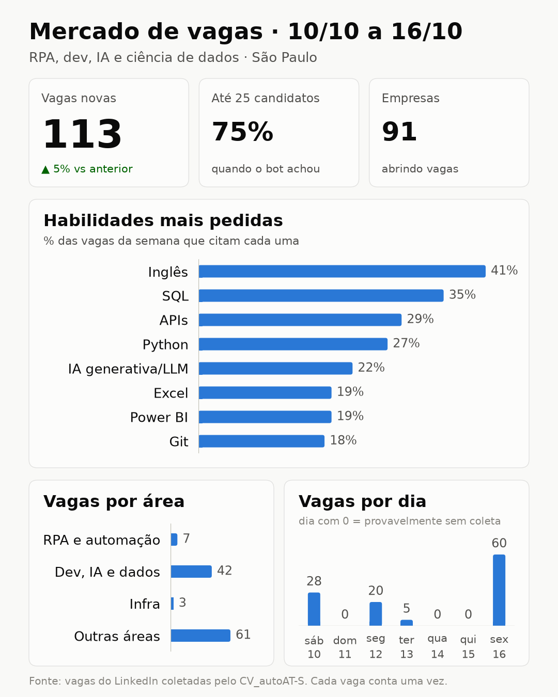
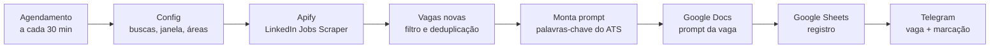
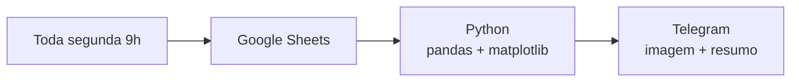

# CV_autoAT-S

Um bot que caça vagas de tecnologia no LinkedIn logo que elas são publicadas e prepara um currículo sob medida para o ATS de cada uma. Feito com n8n, Python e uma enorme preguiça de montar currículo. XD



## Por que existe

Hoje o RH usa IA para filtrar candidatos (os famosos ATS) e o candidato usa IA para escrever o currículo. Só que é muito mais fácil achar ferramenta de análise de currículo do que de personalização para o ATS. O CV_autoAT-S tenta nivelar esse jogo: acha a vaga cedo, descobre o que o ATS dela vai procurar e entrega o prompt pronto para gerar o currículo.

E chegar cedo faz diferença: no primeiro mês, **77% das vagas de tecnologia ainda estavam com até 25 candidatos** quando o bot encontrou.

## O que ele faz

- **Busca a cada 30 minutos** as vagas abertas nos últimos 30 minutos no LinkedIn.
- **Filtra**: descarta vagas antigas e repetidas, com no máximo 10 vagas por rodada.
- **Prepara o currículo**: monta um prompt para cada vaga, já com as palavras-chave que o ATS dela deve procurar (SQL, Python, inglês...), e salva num Google Doc.
- **Organiza**: registra cada vaga numa planilha do Google Sheets, com o link do doc.
- **Avisa no celular**: manda cada vaga no Telegram com o número de candidatos (🟢 🟡 🔴), as habilidades pedidas, o link da vaga e o link do prompt, e marca no grupo quem acompanha aquela área.
- **Relatório semanal**: toda segunda, um script em Python (pandas + matplotlib) analisa a planilha e manda um resumo do mercado no Telegram (a imagem lá em cima).
- **Alerta de erro**: se alguma coisa quebrar, chega um aviso no Telegram.

O currículo em si sai de um Gem do Gemini que já conhece o seu currículo: você cola o prompt e recebe o CV em LaTeX, pronto para virar PDF. A IA ficou fora do n8n de propósito: os modelos gratuitos dentro do fluxo entregavam bem menos qualidade.

## Como funciona





## Estrutura

```
workflows/
  cv-autoats.json          workflow principal
  relatorio-semanal.json   relatório semanal em Python
  alerta-de-erro.json      aviso no Telegram quando algo falha
codigo/                    cópia legível do código dos nós (o que roda é o que está nos JSON)
  config.js                buscas, janela de tempo, áreas, habilidades e quem marcar
  vagas-novas.js           filtro de vagas antigas, deduplicação e limite por rodada
  monta-prompt.js          prompt do currículo, palavras-chave do ATS e mensagem do Telegram
  relatorio_semanal.py     análise e gráfico do relatório semanal
docker/
  docker-compose.yml       n8n + task runner (JavaScript e Python)
  Dockerfile               runner com pandas e matplotlib
  n8n-task-runners.json    módulos que o Python pode importar
  .env.example             token entre o n8n e o runner
```

## Stack

| Peça | Para quê |
|---|---|
| [n8n](https://n8n.io) 2.9 (Docker) | orquestra tudo |
| Task runner do n8n (JavaScript + Python 3.13) | executa o código dos nós; pandas e matplotlib no relatório |
| [Apify](https://apify.com) – `curious_coder/linkedin-jobs-scraper` | coleta as vagas do LinkedIn |
| Google Sheets e Google Docs | planilha de vagas e um doc com o prompt de cada uma |
| Bot do Telegram | entrega as vagas, o relatório e os alertas no celular |
| Gemini (Gem) | gera o currículo em LaTeX a partir do prompt |

## Como rodar

1. **Suba o n8n com o runner.** Na pasta `docker`, copie `.env.example` para `.env`, troque o token por um texto aleatório e rode:
   ```bash
   docker compose up -d --build
   ```
   O n8n fica em http://localhost:5678. Os dois containers sobem sozinhos quando o Docker inicia.
2. **Importe os três workflows** da pasta `workflows` no n8n.
3. **Escolha as credenciais** em cada nó: Apify, Google Sheets, Google Docs e Telegram.
4. **Crie a planilha** com estas colunas (repare no espaço no fim de `Job Title ` e `No Aplicants `): `Job Post Link`, `Job Title `, `Seniority Level`, `Posted At`, `Company Name`, `Company Website`, `Salary`, `No Aplicants `, `Description`, `prompt`, `titulo CV`. Selecione ela nos nós do Google Sheets.
5. **Preencha o que é seu:**
   - `ID_DA_PASTA_NO_DRIVE` no nó "Create a document" (pasta onde ficam os prompts);
   - `SEU_CHAT_ID` nos nós do Telegram (o ID do grupo é um número negativo; aparece em `https://api.telegram.org/bot<TOKEN>/getUpdates` depois de mandar uma mensagem no grupo);
   - o nó **Config**: links de busca do LinkedIn, limites, habilidades, áreas e quem marcar em cada área (o @ ou o ID numérico do Telegram de cada pessoa);
   - o nome no título do doc, no nó **Monta prompt** (`CV - Seu Nome`).
6. **Ligue o alerta**: no workflow principal e no relatório, em *Settings → Error Workflow*, escolha "CV_autoAT-S - alerta de erro".
7. **Publique os três workflows.** No n8n 2.x o workflow de alerta também precisa estar publicado, senão ele não roda.

Para ver o relatório sem mandar nada no grupo, abra http://localhost:5678/webhook/relatorio-semanal.

## Custo

Dá para rodar de graça: o n8n é self-hosted, e Google, Telegram e o Gemini não cobram nesse uso. A única parte paga é o Apify, que dá **US$ 5 de crédito por mês** no plano gratuito, e o ator cobra **US$ 0,002 por vaga** (valores de outubro de 2026). Isso dá umas 2.500 vagas por mês. No ritmo de ~5 vagas por rodada, cabem umas 250 horas de bot ligado por mês, cerca de 8 horas por dia.

## Aprendizados (as partes divertidas)

- **O Telegram e o `_`.** Na V2, o doc do prompt era criado e apagado até o ID dele não ter `_`, porque esse caractere quebrava a mensagem. O culpado era o modo Markdown, que o nó do Telegram usa por padrão: com HTML, a gambiarra se aposentou.
- **O `OR` do LinkedIn.** Com aspas e parênteses, o LinkedIn mistura os termos e um deles some do resultado. Sem aspas e sem parênteses ele soma as buscas, mas ordena por relevância. Por isso são duas buscas: uma de RPA e cientista de dados, outra de desenvolvedor e IA.
- **Uma vírgula quase apagou tudo.** O volume do Docker estava montado em `/home/node/,n8n` em vez de `/home/node/.n8n`, então os dados viviam só dentro do container. Agora ficam num volume nomeado, com backup antes de qualquer mudança.
- **O runner de Python e o "metaclass conflict".** Antes de cada execução, o runner apaga da memória os módulos fora da lista permitida, e o pandas e o matplotlib quebram ao carregar de novo. A solução foi liberar a biblioteca padrão inteira (`"*"`); o runner fica num container isolado, sem acesso aos dados do n8n.
- **"25 candidatos" não é 25.** O LinkedIn mostra "seja um dos 25 primeiros" e o scraper registra 25. Por isso o relatório usa "% de vagas com até 25 candidatos" em vez de média.
- **Ruído de busca.** Uma busca por "automação de processos" trazia vagas de SAP, financeiro e vendas. O relatório separa o que é de tecnologia do que não é.

## Próximos passos

- Nota de compatibilidade entre a vaga e o currículo.
- Um modelo de machine learning (TF-IDF + regressão logística) que estima a chance de uma vaga te interessar, treinado com as suas marcações na planilha.
- Cobrir o período em que o PC ficou desligado.
- Rodar numa máquina sempre ligada.

## Licença

[MIT](LICENSE)
